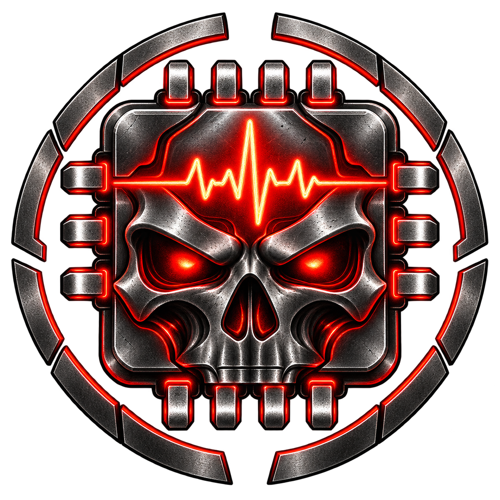

<p align="center"></p>

# DeadWare

**Your hardware and network, in one clear view.**

[](https://github.com/DeadeyeDuncan/DeadWare/actions/workflows/build.yml)
[](LICENSE)

DeadWare is a Windows desktop monitor for watching CPU/GPU usage and temperatures, RAM usage and application network activity. Keep the dashboard open, detach a graph, or use the compact desktop widget.

Connections is available starting with version 0.6.21.

## Features

- CPU and GPU utilization and temperature graphs with detected device names.
- Optional GPU fan RPM on temperature graphs, with a separate scale and saved history.
- A combined download/upload graph with a shared scale and distinct line styles.
- Per-application network rates when Windows permits ETW capture.
- Connections: a native globe or 2D map, visible-node list and connection detail boxes, local saved history and an optional live widget map.
- Searchable sensor readings with minimum, maximum and average values.
- Selectable graphics adapters on multi-GPU systems.
- Separate or joined CPU/GPU graph windows and a compact widget with usage, temperature, RAM and network charts and always-on-top controls.
- Compact pop-out graphs prioritize the current reading and chart; their options menu holds history range, Always on top and sensor statistics.
- Close the dashboard to the system tray and keep graphs, the widget and monitoring running independently.
- Restore the graphs and widget left open, including their saved positions and sizes.
- Optional administrator startup at your Windows sign-in.
- Shared 1-, 5- and 15-minute plus 1-, 3- and 6-hour graph ranges; all windows use one collector. Choose a range from the dropdown above the dashboard or in a pop-out's **⋯** menu. The dropdown follows the selected app theme, and its selected range stays synchronized across windows. The choice and recent CPU/GPU/RAM/network traces are saved locally across quits and computer restarts. Cooling Health's longer saved history is separate. At 1–6 hours, a per-pixel average line shows the trend and a faint min/max band retains spikes and variation. Missing readings remain gaps, and displayed statistics use the actual readings. Short ranges retain their detailed traces. In **Settings**, turn **Smooth long-range graphs (1, 3 and 6 hours)** off to use raw traces across the dashboard, pop-outs and widget. The choice is saved; raw traces retain observed peaks and gaps without the average/range band.
- Local Cooling Health history, fixed reference comparisons, CSV export and optional sustained-change warnings.
- Lifetime battery-percentage history with recorded charging and Windows battery-saver periods, Day/Week/Month/Year/All views, CSV export and a separate remembered window.
- Startup and manual GitHub release checks, update-available notices, verified user-initiated updates and rollback to the previous installed version.
- Seven saved themes: **Midnight**, **Ember**, **Glacier**, **Amethyst**, **Neon**, **Blackout**, and **Daylight**. Choose **Blackout** for pure-black backgrounds and panels, neutral controls and borders, and distinct graph colors. Choose **Neon** in the sidebar's **Color theme** menu for near-black surfaces, electric cyan accents, and vivid green, magenta and blue graphs.
- Scrollbars follow the selected theme across all windows, with matching native title bars on Windows 11.
- Themes coordinate text colors and fonts across headings, controls, tables, graph labels and tooltips, and update open windows immediately.
- Use the filled circles in each Overview graph's corner to choose its line color, **Default / Solid / Dashed / Dotted** pattern, **Line thickness** (50–300%) and optional **Neon glow** with **Glow strength** (0–300%). 100% preserves the original thickness/glow. Choices are saved and shared with pop-outs, widget traces and legends; download and upload have separate colors. Choose **Theme default** to clear a custom color; choose **Default** under Line style, return both sliders to 100%, and turn off glow to restore the original trace style.

## Download and run

Get the Windows x64 ZIP from [Releases](https://github.com/DeadeyeDuncan/DeadWare/releases). Extract the **entire** archive and run `DeadWare.exe` inside the `DeadWare` folder. The .NET runtime is bundled. The app is portable and unsigned. Version 0.6.0 adds manual update and rollback controls; older installations need one complete ZIP upgrade to gain those controls.

Windows 10/11 x64 is the target. ARM64 and other operating systems are not validated. Hardware coverage varies by device.

Start as a normal user. If a capability needs additional permissions, the app shows its status and provides an explicit administrator restart action. Administrator access does not guarantee every sensor is available. DeadWare does not disable Windows protections or install a custom monitoring driver.

## Updates and rollback

DeadWare checks the latest normal release in `DeadeyeDuncan/DeadWare` once after starting, without delaying monitoring. When a newer version is available, a dashboard banner appears outside the Updates page and a system-tray notification lets you know; **Review update** opens Updates. You choose when to download and install it with **Update & restart**. You can also choose **Check for updates** on that page at any time. Checks do not download app packages or install anything. Draft/preview releases and source commits are excluded, and an installed newer build stays on its current version. Offline or rate-limit errors appear on Updates without interrupting startup. There is no recurring polling while the app remains open.

Release notes include every normal release newer than the installed version through the offered update, newest first, with separate version headings. If earlier notes cannot be loaded, the page keeps the latest notes and explains the missing history. Installation still uses the latest eligible package.

Choose **Show release note history** in Updates to browse all normal published versions, including the installed version and older releases, newest first. Each explicit opening refreshes the history from GitHub; it is not fetched at startup. **Hide release note history** returns to the usual current or missed-version notes. Loading can be cancelled, and a failed history request can be retried without changing the offered update.

When an eligible update is available, **Update & restart** downloads the complete Windows x64 ZIP, checks its SHA-256 digest/checksum and validates the package's file manifest. Download/preparation can be cancelled. Once the installer is ready, DeadWare performs its normal Quit to save settings and drain history, replaces only managed app files, and restarts at the same path with remembered windows. Settings and battery/Cooling Health/live graph databases stay in `%LOCALAPPDATA%\DeadWare`.

**Roll back & restart** restores the previous verified installed version, keeping current settings and recordings. The first updater-enabled installation may have no registered rollback; one becomes available after an in-app update. Only a verified older backup is offered. If replacement or startup fails, the helper restores the previous app when the failed process has exited. It never forcibly terminates monitoring or overwrites a still-running replacement. A running app that did not confirm startup must be quit normally before rollback/recovery can proceed.

Updates require the complete packaged app directory, including `deadware-package.json` and `DeadWare.Updater.exe`, and permission to write app files. Shortcuts and Windows startup keep their existing executable path. Verification failures, offline checks and unavailable backups leave the current installation intact. Update checks/downloads contact GitHub and do not upload monitoring data. Update staging, the previous snapshot and operation results are stored in the local `updates` directory, partitioned by installation path.

New tagged versions are published as normal GitHub releases with ZIP/checksum assets. Older historical previews remain archived and are ignored by the updater. Publishing a release is separate from pushing source to a branch or opening a pull request.

## Startup and saved workspace

In **Settings → Data polling interval**, choose 0.5, 1, 2, 5 or 10 seconds. One second is the default. Changes are saved and apply after the current wait or reading finishes, without restarting. Faster polling uses more resources; slow hardware may take longer than requested. Every window shares this collector, and the display refreshes twice per second at the fastest setting. The six-hour graph range is retained. Cooling Health records at every setting, but 5- and 10-second polling has too few samples per minute for its reference comparisons.

In **Settings**, enable **Start with Windows** to launch DeadWare as administrator when you sign in. Windows approval is needed to configure this option. It creates a task for your Windows account, runs only in your signed-in session, and stores no password. You can turn it off from the same page. Only one monitoring instance runs at a time.

For a quiet sign-in, also enable **Start in the system tray**. This hides the dashboard only for Windows startup launches. Remembered graphs and the widget still reopen when restoration is enabled; turn restoration off too if you want only the tray icon. A fresh manual launch still shows the dashboard. If the tray icon cannot be created, the dashboard stays accessible.

Closing the dashboard with its X or Alt+F4 hides it in the system tray. Pop-out graphs, the widget and monitoring keep running, even with no dashboard open. Double-click the DeadWare tray icon or right-click it and choose **Show dashboard** to reopen it. Windows may place the icon in the hidden-icons area next to the clock.

To fully stop monitoring, choose **Quit DeadWare** from the tray menu or dashboard. Keep window restoration enabled and leave your desired graphs and widget open when you quit: they will reopen with their saved positions, sizes and always-on-top choices. Closing a graph or widget individually keeps it closed next time. Positions are kept within available monitors if your display setup changes. Recent graph history and saved Cooling Health history remain available after quitting. Hiding the dashboard resets neither.

Graph history is saved automatically in `%LOCALAPPDATA%\DeadWare\live-graph-history.db`, independently of Cooling Health recording. It retains the last six elapsed hours of CPU/GPU usage and temperature, GPU fan RPM, RAM usage percentage and combined download/upload rates. RAM uses a 0–100% scale with current used/total memory shown beside it; its history begins with readings collected in version 0.6.11 or later. GPU fan history begins with readings collected in version 0.6.20 or later; earlier samples remain unavailable. Time while DeadWare was stopped remains a gap; after more than six hours away, the old readings fall outside the available range. Current values always come from fresh readings. Writes run in the background every 15 seconds and flush on normal quit; a crash or abrupt power loss can lose the latest unsaved batch. The database is capped at 64 MiB with a bounded journal. A save error is shown in the dashboard status while live monitoring continues.

Restoration matches local machine and hardware metadata, including GPU model/type rather than enumeration order. Ambiguous identical-model GPUs are not restored; an indistinguishable same-model physical replacement cannot always be detected. Full sensor-table statistics and the Network page's per-application traffic totals remain current-session data. Connections has its own optional saved endpoint history, described below. The first upgrade from a version without graph persistence cannot recover its earlier in-memory traces.

Version 0.1.0 saved window positions but did not record which windows were open. After upgrading, arrange your desired windows once to establish the saved workspace.

Startup points to the executable's current location. Keep the extracted folder in a permanent location. If you move it, enable startup again from the new location; disable startup before removing the app. Choose **Quit DeadWare** before replacing files during an upgrade; closing the dashboard alone leaves it running.

## Graph pop-outs

Use the overview cards' **Pop out** buttons to open graphs. In **Settings → Graph pop-outs**, enable **Join CPU and GPU graphs in pop-outs** to put CPU and selected-GPU usage together on one chart, and both temperatures together on another. The option is off by default. CPU keeps its theme color and solid line in both charts; GPU keeps its own color and dashed line. Both current readings and device statistics are available, with a shared 0–100% usage scale and a shared temperature scale that expands above 100°C when needed.

The choice applies to new pop-outs. Existing open windows and remembered layouts keep their current form, and joined and separate windows remember their own positions, sizes and pin choices. RAM, Network and Battery history windows keep their existing behavior. Open the widget from the dashboard's **Open widget** button.

In **Settings**, enable **Show GPU fan speed on temperature graphs** to add the selected GPU's first reported fan RPM to the dashboard GPU temperature graph, separate or joined GPU temperature pop-outs, and the widget temperature graph. This saved option is off by default and applies immediately to open graphs. Fan speed uses a dotted line in the theme's warning color (amber by default) and a separate left RPM scale; temperature keeps the right °C scale. A missing fan reading stays unavailable and leaves a gap. A reported 0 RPM is a valid stopped-fan reading.

## Desktop widget

The widget's pin control is in **Settings → Widget always on top**. Changes update an open widget immediately and are saved even when it is closed. Earlier saved widget pin choices carry over. Other graph windows keep their existing Always on top controls.

Choose the displayed graphs in **Settings → Widget graphs**: CPU/GPU usage, CPU/GPU temperature, RAM usage and Network activity. All four are enabled by default. **Connections map (live)** is a separate option, off by default. Use it alone or alongside any selected graphs. Choices are saved and apply immediately to an open widget. Hidden graphs keep collecting history. Turning graphs off lowers the minimum height while keeping your current size and pin choice; resize the widget to your preferred height. If all graphs and the map are off, the widget shows a hint to choose graphs in Settings.

The compact widget has a **Usage** graph with CPU and selected-GPU utilization together, followed by a **Temperature** graph with both devices' temperatures together. CPU uses the CPU theme color and a solid line in both graphs; GPU uses the GPU theme color and a dashed line in both. Small CPU/GPU legends show the current readings. Usage shares a 0–100% scale; temperature shares a °C scale that expands above 100°C when needed. A third **RAM** graph shows physical memory usage on a 0–100% scale, with current percent and used/total memory in its legend. A fourth **Network** graph shows download as a solid blue line and upload as a dashed green line on one bytes-per-second scale, with current rates in its legend. These graphs follow the shared history range and GPU selection, use saved graph history, and keep unavailable readings and downtime as gaps. The Connections map always uses current live observations, independently of the main page's History selection or playback. The map sits below the selected graphs. Its compact 2D view fills the available panel with only the map, without text labels, speed readouts or history controls. The small NA button switches between World and a closer North America view and saves the selection. In either view, drag the map to pan and use the mouse wheel to zoom; keyboard arrows and +/− work when the map has focus. Home resets the current region. Custom pan/zoom stays in place during live refreshes and Home-city changes, and resets when switching region or reopening the widget. Details remain on the main Connections page. The widget's minimum height follows the selected graphs and map; small work areas allow scrolling instead of clipping selected content.

## Connections

Both the main map and widget include subtle offline country borders. Connection arcs use fine layered filaments with restrained glow; selecting a connection highlights its strands. Active strands drift gently, while stopped animation, quiet traffic and unavailable capture remain static. Upload/download colors and direction markers remain distinct.

Open **Connections** beside Network for live observed destinations on a rotatable globe or a 2D world map. Drag, zoom, reset the view or pause animation, and filter by application, country and traffic direction. The compact list shows only nodes visible in the current map view, following rotation, zoom and the selected Live or History mode. Click a node or its list entry to open a detail box beside it with application/PID, remote IP/port, TCP/UDP, approximate location, observed bytes, rates, coverage and observation times. The box follows the node, hides when it moves out of view, and closes with **Close** or **Escape**. Private/LAN, special and unlocated addresses remain in summary totals and saved-history CSV exports. This is observed traffic, so an idle socket need not appear.

Download/upload colors and moving highlights show observed direction; bounded marker sizes and path widths indicate relative volume. Quiet or stale traffic stays static, and stopped History does not animate. Live totals cover currently active peers since their first retained observation, rather than all session traffic. The map draws at most 256 grouped locations and discloses omitted groups. List entries show grouped-location byte totals; detail boxes identify a representative connection with its own rates and bytes, separately from location totals. Selecting a saved node reads its representative directly, including observations beyond the former table's first page. IPv6 endpoints use `[address]:port` notation.

**History** offers Today, 7 days, 30 days or a chosen interval, with a minute cursor and playback. Each saved row's rate is its recorded-minute bytes divided by 60 seconds, independent of the selected range. Incomplete minutes remain marked incomplete; the average does not imply continuous capture. Missing time, paused recording, capture loss, sleep and stopped capture remain gaps. Empty intervals do not invent traffic. The optional widget map continues showing live activity while this page shows history, and recording continues when the dashboard is hidden.

Location lookups use a local [DB-IP City Lite database](https://db-ip.com/db/download/ip-to-city-lite), credited to [DB-IP.com](https://db-ip.com/) under [CC BY 4.0](https://creativecommons.org/licenses/by/4.0/). The database is not bundled. **Download / update locations** explicitly contacts `download.db-ip.com` over HTTPS to fetch the monthly database; progress and cancellation are available, and a failed update keeps the previous valid database. There are no automatic database downloads or per-address online queries. Observed peer IPs are never submitted to a geolocation or DNS service. The download's own traffic may appear in Connections. Local lookups work offline afterward; Summary totals and history recording work without a location database; nodes and their details require located endpoints.

Choose an optional approximate **Home city** from the offline list under **Recording, origin and storage**. Animated connection paths require this origin, current located traffic, Live mode and Animate enabled. Until then, the map says **Unknown origin** and assigns this computer no geographic position. DeadWare does not request precise Windows location or discover your public IP online. Geographic results can be wrong or incomplete, especially with VPNs, CDNs and proxies. Curves illustrate endpoint links, not measured routes. An endpoint's city/country does not establish final data storage, the ultimate service location, or whether traffic is safe or threatening.

Connections recording is optional and **on by default**. Pause/resume it with the recording checkbox beside the location-database actions; rolling expiry continues while new recording is paused. Minute records in `%LOCALAPPDATA%\DeadWare\connections.db` retain application identity/name, remote IP/port, protocol, observed byte counts/times, completeness and the approximate location/origin available when recorded. A later location-database update does not relocate old records. History starts when this feature records; it cannot reconstruct earlier activity. Export the current filtered history to a new local CSV when needed.

History normally retains 30 days, with a 256 MiB primary-database cap and a bounded journal. High traffic can evict older whole minutes earlier; the page shows the actual earliest retained time. Intended older-history eviction can remain in effect even if a later write fails. Background writes target a 15-second flush interval and drain on normal **Quit DeadWare**. A crash or power loss can lose the unflushed batch; delayed or failed storage can extend that interval and produces incomplete/unavailable recording status. Storage failures leave live monitoring available. History stays in this Windows profile and is not uploaded or copied by source synchronization. Back up databases only while DeadWare is fully quit.

## Hardware compatibility

DeadWare discovers hardware rather than assuming a particular PC. [LibreHardwareMonitor](https://github.com/LibreHardwareMonitor/LibreHardwareMonitor) supplies supported sensor data; Windows counters provide basic fallbacks. Support varies by CPU, GPU, motherboard, laptop firmware, drivers and permissions. Missing sensors are shown as unavailable, and missing history remains a graph gap.

The default hardware scan focuses on CPU and GPU sensors. Extended motherboard, controller, storage and memory-device sensors are optional and off by default, since low-level polling can affect responsiveness on some machines. Changing this setting requires restarting DeadWare. Windows memory usage remains available without extended scanning.

This first release is **not complete HWiNFO sensor parity**. A successful launch on one PC is not evidence that every sensor works on every device. Please report compatibility findings through the hardware issue template with device models and the capability message, without serial numbers.

## Battery history

Open **Battery history** in the sidebar to see how charge drops and recovers, along with current charging status. The charge line shows Windows battery-saver periods: the normal solid line means saver off, dashed amber means saver on, and dotted gray means unknown state. A legend identifies each style. Choose **Open in window** for a separate resizable window; its position, size and Always on top choice are remembered. The Day/Week/Month/Year/All history selector is independent of the live graph range. When Windows reports no battery, the sidebar entry hides automatically; it returns if a battery is detected or its status is unknown. Saved battery history is kept.

DeadWare records the system battery total once per minute plus observed charging/power and battery-saver state changes. Recording starts automatically on a battery-equipped device and can be paused without deleting saved history. Windows supplies these readings without administrator access. Unknown readings stay unavailable; a desktop with no battery says so. Multiple physical batteries appear as the combined system charge.

Observations are kept indefinitely in `%LOCALAPPDATA%\DeadWare\battery-history.db`, independently of the six-hour live graph cache and Cooling Health retention. There is no automatic expiry or size-based deletion. Storage usage and recording errors appear on the page. The database grows with recorded observations; long-range charts use bounded summaries without deleting originals. Dots show percentage averages and vertical lines show minimum–maximum in each displayed bucket. Hollow charge dots indicate mixed or unknown saver state within a summarized bucket. Green marks identify recorded charging and amber marks identify battery saver; filled marks mean all observations in a bucket reported that state, and outlined marks mean mixed states. They do not establish the state during unobserved time. Missing data, sleep, pauses and restarts remain gaps.

History begins with this version while DeadWare runs; earlier device history cannot be reconstructed. Writes flush every 15 seconds and on normal **Quit DeadWare**. Abrupt power loss can lose the unsaved batch. A storage problem reports an error while the other monitors continue. Resolve storage access and restart to retry. Battery data stays local to this Windows profile; source-code synchronization through GitHub does not copy it to another computer. Export the selected range to a new CSV for a backup, or copy the database while DeadWare is fully quit. Keep your own backup before resetting Windows or deleting the profile. Do not synchronize an open database.

## Cooling Health

The **Cooling Health** page saves local CPU/GPU temperature, usage and package power, plus clock and fan readings when supported. Recording starts by default; optional tray notifications start off. Choose a device and day/week/month range, switch metrics or export a new CSV file. Settings and the SQLite history database live under `%LOCALAPPDATA%\DeadWare`. No thermal data is uploaded. Per-application network data is not stored there.

The first minute produces a history window. To compare cooling, select a past period of up to seven days when you believe the setup was operating normally and save it as a named reference. At least 30 eligible minute windows are needed. The first five minutes, gaps, unstable workloads, missing required readings and known throttling are excluded; learning can therefore take longer than 35 minutes. Saved reference readings stay fixed rather than learning a developing problem as normal.

Comparisons need ten consecutive stable recent minutes, each matched to at least ten reference windows within 10% or 5 W of package power (whichever is larger), ten percentage points of load, and comparable fan speed when both sides provide it. The initial warning rule requires every recent minute to exceed the reference mean by at least 5°C and its 95th percentile by at least 3°C. These conservative engineering defaults are not validated probabilities of hardware failure. Coolant and room temperature are not measured by this first implementation; fan context may also be unavailable. Temperature-target boosting can conceal cooling deterioration, so an ordinary comparison is not a health certificate.

Warnings are logged even when tray notifications are muted. Enable notifications if desired; warnings can be acknowledged and are limited to one per device/reference per 24 hours. An unacknowledged warning suppresses repeats. Changing the active reference does not modify its saved readings. Choose **New cooling setup** after hardware replacement (including a replacement with the same model), cleaning, remounting, fan-curve or power-limit changes. Local identity uses machine, hardware metadata and the selected sensor mapping; it cannot identify every physical replacement automatically. When multiple devices have identical model names, their histories are separated by session and comparison is disabled because enumeration cannot establish physical identity. Older setups remain available for history viewing.

By default, minute detail is retained for 30 days and hourly summaries for 90 days. Controls offer 7/30 days of detail and 30/90 days of summaries. The database is capped at 256 MiB with a bounded journal; the page shows storage usage. Up to ten references per device/setup are retained. If storage is locked, full or corrupt, recording reports an error and live monitoring continues; resolve the storage issue and restart to retry. Saved references can consume space independently of ordinary history retention. Database files are local to this Windows profile; cloud synchronization of an open database is not supported.

Cooling Health flags changes worth investigating. It cannot diagnose a blocked cooler, failing pump, or remaining lifespan. Pump/flow/coolant-specific monitoring needs confirmed supported sensors and is not included yet.

## Network measurements and privacy

Interface totals work independently of per-process attribution. Application traffic uses Windows ETW metadata, including TCP/UDP IPv4/IPv6 byte events. Connections optionally saves endpoint metadata locally as described above; recording starts enabled. The app never collects packet payloads, URLs, messages or file contents, and does not upload observed endpoints, application names or histories. No firewall management is included.

Rates reflect observed traffic, not ISP billing totals. Adapter totals and attributed application traffic may differ due to virtual adapters, local traffic, protocol overhead or lost events. The combined network graph's last six hours are stored locally; per-application activity and names are not persisted in that graph cache. Connections history is separate, optional and bounded. Thermal history is stored separately as described above. Settings are kept in the user's local application-data directory. Explicit location-database downloads contact DB-IP's download host; update checks/downloads contact GitHub.

Diagnostic output is generated only when explicitly requested. It can include hardware names and running application information; redact it before attaching it to a public issue.

For local troubleshooting, `DeadWare.exe --diagnose output.json --samples 3` collects a short sample and exits. Add `--no-hardware` to isolate Windows counters and network tracking, or `--no-etw` to isolate hardware collection from per-app tracing. Diagnostics include provider timings. Avoid enabling extended sensors when investigating a responsiveness problem.

For workspace-saving problems, start the app with `--layout-diagnostics "C:\path\layout.jsonl"` using an absolute local output path. This opt-in, size-limited trace records settings paths, open-window IDs and save results; it follows an administrator restart and contains no sensor readings or network traffic. Use a new file or a previous DeadWare layout trace. Treat it as private diagnostic data.

## Build

Install the stable [.NET 10 SDK](https://dotnet.microsoft.com/download/dotnet/10.0) on Windows, then:

```powershell
dotnet build DeadWare.slnx -c Release
dotnet test DeadWare.slnx -c Release
dotnet run --project src/DeadWare.App/DeadWare.App.csproj
```

Create a self-contained portable ZIP and SHA-256 checksum:

```powershell
pwsh -File scripts/publish.ps1 -Version 0.6.32
```

The packaging script runs tests before publishing, bundles the independent self-contained update helper, and records all managed file hashes in `deadware-package.json`. Output goes under `artifacts/`. GitHub Actions runs the same script. Pushing a normal three-part version tag such as `v0.6.0` builds and publishes a normal release after tests pass, using the matching `docs/releases/v0.6.0.md` notes. Workflows use pinned action commits.

## Project direction

For development across computers, use the [GitHub synchronization workflow](docs/development.md). Source checkouts and installed portable app folders have separate purposes; committed changes and versioned packages identify what each computer is using.

The first release focuses on everyday monitoring, hardware adaptability and usable detached windows. Future work can expand compatibility validation, long-term usage history, signed installers and additional telemetry sources. Development plans are in `docs/superpowers/`.

Original code is MIT licensed. Dependencies retain their own licenses; see [third-party notices](THIRD-PARTY-NOTICES.md). The icon was created for DeadWare to match the owner's Dead app branding; its generation details are in [assets](assets/README.md).
