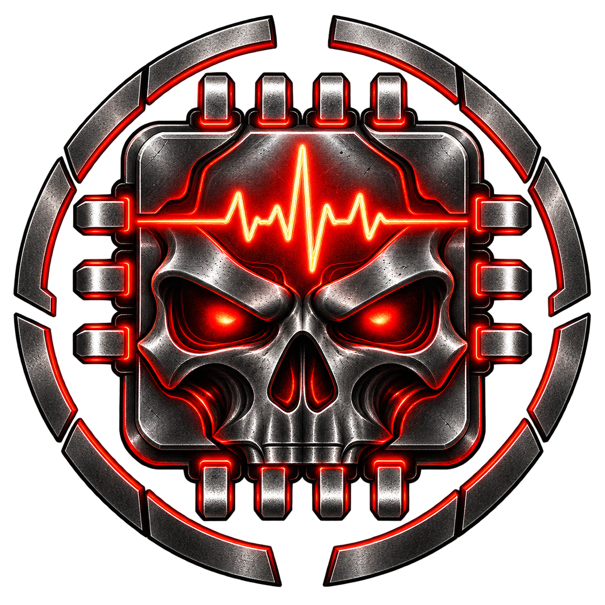
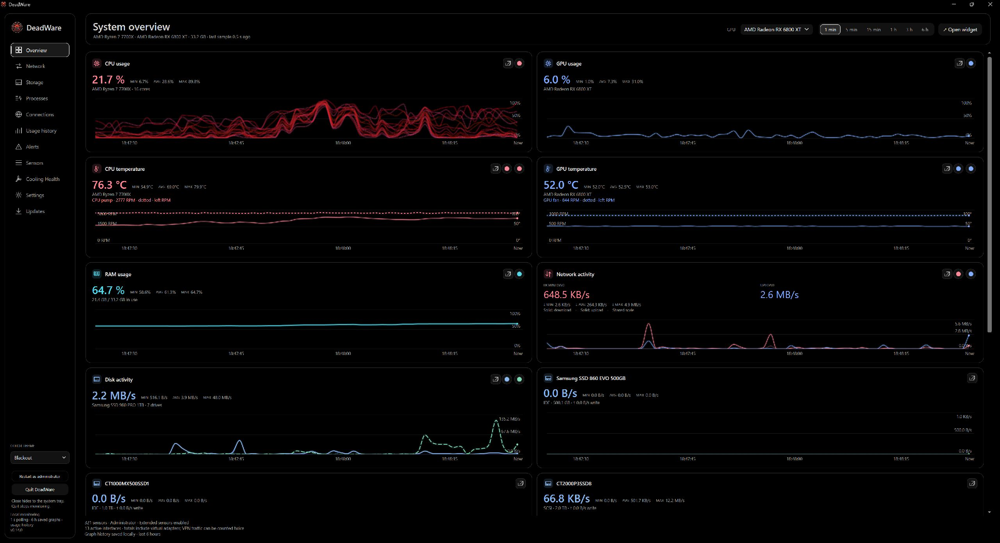
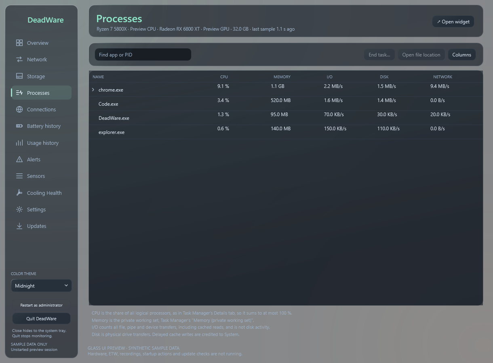
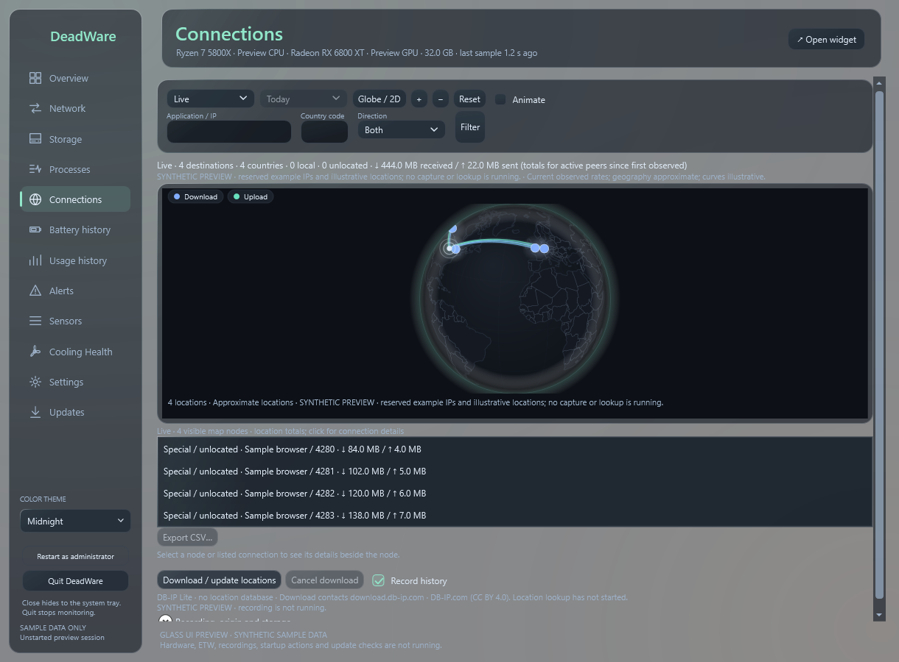
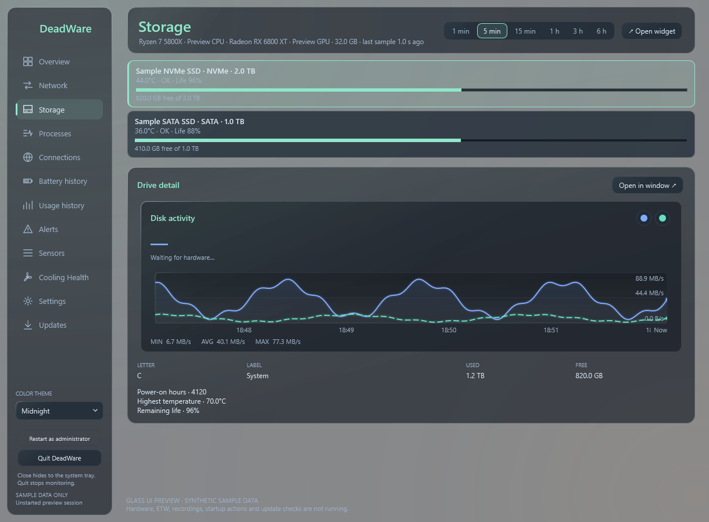
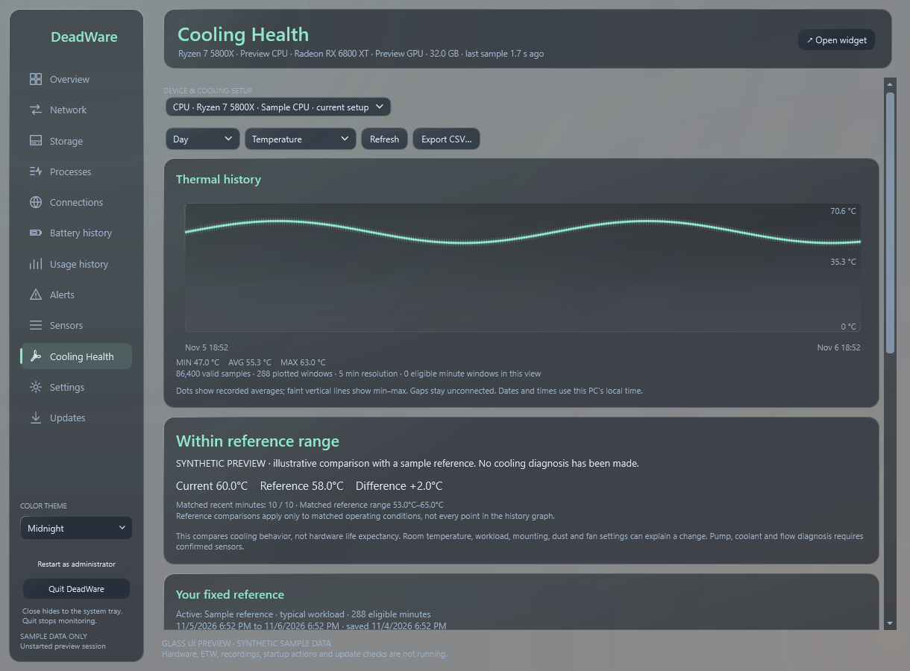

# DeadWare

**Your hardware and network, in one clear view.**

DeadWare is a Windows desktop monitor for CPU, GPU, memory, drives and network activity. Watch live graphs, find busy applications, explore connections on a globe, or keep a compact widget beside your work.

[**Download for Windows**](https://github.com/DeadeyeDuncan/DeadWare/releases/latest) · [User guide](https://github.com/DeadeyeDuncan/DeadWare/blob/main/docs/user-guide.md) · [Release notes](https://github.com/DeadeyeDuncan/DeadWare/releases)

*Live dashboard on Windows.*

## What you can do

- **Watch your hardware:** live usage and temperature graphs, per-core CPU traces, supported fan/pump readings, drive throughput, storage health and searchable sensors. Choose graph ranges from one minute to six hours.
- **Find busy apps:** group processes by application and compare CPU, memory, I/O and GPU, with expandable rows and customizable columns. Per-app disk and network rates require administrator access.
- **See your connections:** explore observed destinations on a globe or 2D map, filter by application, replay locally saved history, see when each app used the network and list every destination. Locations are approximate; arcs illustrate connections, not measured routes.
- **Look back:** review device and application usage, battery charge and Cooling Health. Export CSVs, compare cooling against a saved reference, set your own threshold alerts, get an alert the first time an app uses the network, and keep chosen apps out of history or clear it.
- **Build your workspace:** detach graphs, use the compact widget, pin windows above other apps and restore their positions. Monitoring continues in the tray when the dashboard closes.
- **Make it yours:** choose from nine themes, optional window glass and saved graph colors, line styles and glow.

## In action

The dashboard above is a live capture. Feature previews below use the app’s own renderer with sample data.

| Processes | Connections |
| --- | --- |
|  |  |
| Find which applications are using resources. | Explore where observed network traffic goes. |

| Storage | Cooling Health |
| --- | --- |
|  |  |
| Check drive activity, temperature, health and free space. | Track temperatures and compare cooling over time. |

## Get started

Download the **Windows x64 ZIP**, extract the **entire** archive and run `DeadWare.exe` inside the `DeadWare` folder. The .NET runtime is included. DeadWare is portable and unsigned; Windows 10/11 x64 is the target. Other platforms are not validated.

Use **Updates → Update & restart** for in-app upgrades, and **Quit DeadWare** before replacing files manually.

Monitoring histories stay on your PC. DeadWare does not upload observed activity or collect packet contents. Release checks contact GitHub; optional location-database downloads contact DB-IP. See the [privacy and measurement details](https://github.com/DeadeyeDuncan/DeadWare/blob/main/docs/user-guide.md#network-measurements-and-privacy).

## More

[Full user guide](https://github.com/DeadeyeDuncan/DeadWare/blob/main/docs/user-guide.md) · [Build from source](https://github.com/DeadeyeDuncan/DeadWare/blob/main/docs/user-guide.md#build) · [Development workflow](https://github.com/DeadeyeDuncan/DeadWare/blob/main/docs/development.md) · [Report an issue](https://github.com/DeadeyeDuncan/DeadWare/issues/new/choose)

Original code is [MIT licensed](LICENSE). See [third-party notices](THIRD-PARTY-NOTICES.md) for dependency licenses and attribution.
